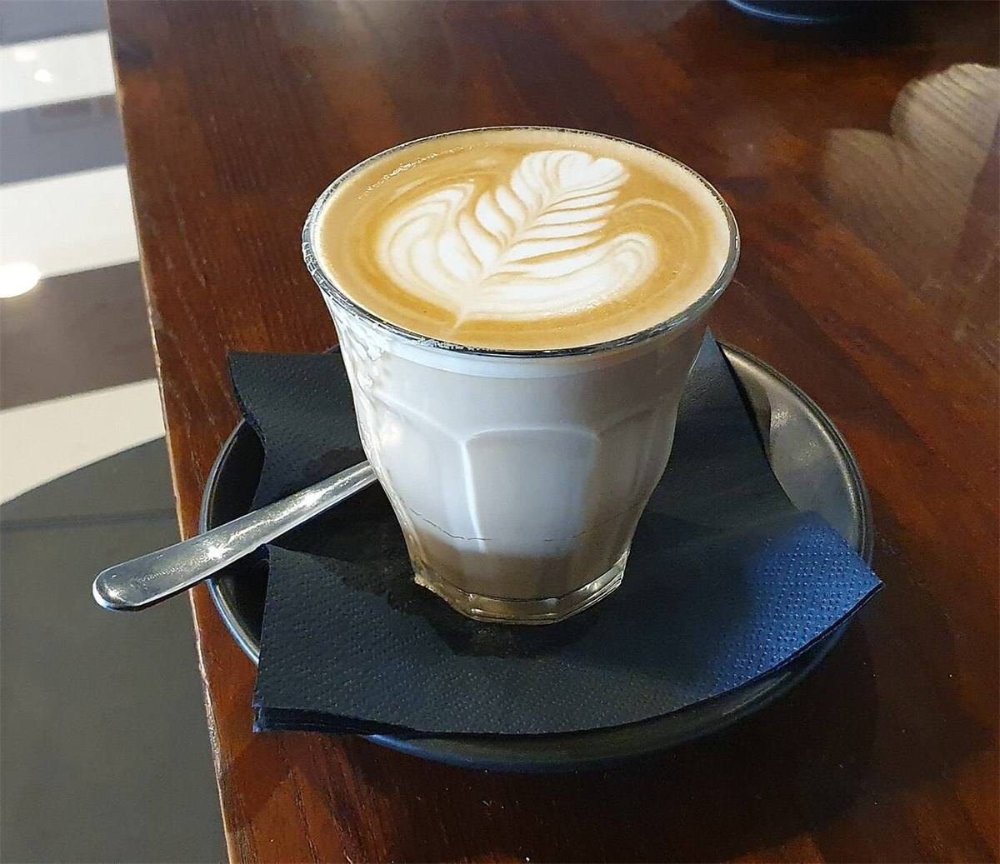

# MELLOW BEAN 카페 웹사이트 제작 가이드

이 문서는 MELLOW BEAN 카페 웹페이지를 만들 때 따라야 할 기준입니다.
사이트를 만들거나 고칠 때는 이 문서를 먼저 읽고, 여기 적힌 결정을 그대로 따릅니다.
결정을 바꾸고 싶으면 코드보다 이 문서를 먼저 고칩니다.

---

## 1. 컨셉

- **카페 이름**: MELLOW BEAN
- **분위기**: 내추럴 & 그린. 식물, 나무, 햇살이 느껴지는 편안하고 싱그러운 카페
- **핵심 키워드**: 부드러움(mellow), 여유, 자연스러움
- **한 줄 소개(예시)**: "천천히, 부드럽게 내린 한 잔"
- **디자인 원칙**
  - 여백을 넉넉하게 둔다. 빽빽하게 채우지 않는다.
  - 사진이 주인공이다. 장식은 최소화한다.
  - 모서리는 부드럽게 둥글린다. 날카로운 각, 강한 그림자, 형광색은 쓰지 않는다.

---

## 2. 색상

CSS 변수로 정의하고, 코드에서는 색상 코드를 직접 쓰지 말고 변수만 사용합니다.

| 변수 | 값 | 용도 |
|---|---|---|
| `--color-bg` | `#FBF9F4` | 페이지 기본 배경 (밝은 크림) |
| `--color-bg-alt` | `#EEF1E8` | 섹션을 번갈아 구분할 때 쓰는 배경 (밝은 연그린) |
| `--color-text` | `#2F3A2F` | 본문·제목 글자 (딥 그린) |
| `--color-text-muted` | `#5E6B5E` | 보조 설명, 가격 옆 설명 등 |
| `--color-accent` | `#8A9A7B` | 포인트 (세이지 그린): 버튼, 구분선, 강조 |
| `--color-accent-dark` | `#6F8062` | 버튼에 마우스를 올렸을 때 |
| `--color-white` | `#FFFFFF` | 카드 배경, 사진 위 글자 |

```css
:root {
  --color-bg: #FBF9F4;
  --color-bg-alt: #EEF1E8;
  --color-text: #2F3A2F;
  --color-text-muted: #5E6B5E;
  --color-accent: #8A9A7B;
  --color-accent-dark: #6F8062;
  --color-white: #FFFFFF;
}
```

- 섹션 배경은 `--color-bg`와 `--color-bg-alt`를 번갈아 써서 구분합니다.
- 전체 톤은 **밝고 화사하게** 유지합니다. 배경을 더 어둡게 바꾸지 않습니다.
- 사진 위에 글자를 올릴 때는 옅은 반투명 막(`--color-overlay: rgba(30, 40, 30, 0.2)`)을 깔고, 글자에 부드러운 그림자(`--text-shadow-photo`)를 줘서 사진은 밝게 두면서 글자는 잘 보이게 합니다.
- 글자색(`--color-text`, `--color-text-muted`)과 버튼색(`--color-accent`)은 밝게 바꾸지 않습니다. 더 밝으면 글자를 읽기 어려워집니다.

---

## 3. 글꼴

컨셉은 **손글씨 포인트**입니다. 손글씨는 포인트로만 쓰고, 긴 글은 읽기 편한 고딕으로 씁니다.

| 용도 | 글꼴 | 비고 |
|---|---|---|
| 로고, 영문 섹션 제목 (About, Menu 등) | **Caveat** | 영문 손글씨 |
| 한글 손글씨 포인트 (히어로 한 줄 소개 등) | **Gaegu** | 한두 줄 이하로만 사용 |
| 본문, 한글 제목, 메뉴 이름, 가격, 버튼 | **Noto Sans KR** | 기본 글꼴 |

Google Fonts에서 불러옵니다.

```html
<link rel="preconnect" href="https://fonts.googleapis.com">
<link rel="preconnect" href="https://fonts.gstatic.com" crossorigin>
<link href="https://fonts.googleapis.com/css2?family=Caveat:wght@500;700&family=Gaegu:wght@400;700&family=Noto+Sans+KR:wght@300;400;500;700&display=swap" rel="stylesheet">
```

```css
:root {
  --font-hand-en: 'Caveat', cursive;
  --font-hand-ko: 'Gaegu', cursive;
  --font-base: 'Noto Sans KR', sans-serif;
}
```

**글자 크기 기준** (데스크톱 / 모바일)

| 요소 | 데스크톱 | 모바일 |
|---|---|---|
| 히어로 로고 (Caveat) | 96px | 64px |
| 섹션 영문 제목 (Caveat) | 56px | 42px |
| 섹션 한글 부제목 (Noto Sans KR 500) | 20px | 18px |
| 본문 (Noto Sans KR 400) | 17px | 16px |
| 작은 글자 (가격 설명, 저작권) | 14px | 14px |

- 본문 줄 간격은 `1.8`로 넉넉하게 합니다.
- 한 줄이 너무 길지 않게 본문 영역의 최대 너비는 `640px` 정도로 제한합니다.

---

## 4. 언어

- **한글 위주 + 영문 포인트**로 씁니다.
- 섹션 제목은 영문 손글씨(About, Menu, Space, Location) 아래에 한글 부제목을 붙입니다.
  - 예: **About** / 멜로우빈 이야기
- 설명문, 메뉴 설명, 주소 등은 모두 한글로 씁니다.
- 메뉴 이름은 한글로 쓰고, 아래에 작게 영문을 붙여도 좋습니다. (예: 카페 라떼 / Cafe Latte)

---

## 5. 페이지 구조

**한 페이지 스크롤형**입니다. 위에서 아래로 다음 순서를 지킵니다.

```
1. Header    상단 고정 메뉴바
2. Hero      첫 화면 (큰 사진 + 로고 문구)
3. About     카페 소개
4. Menu      대표 메뉴 4가지
5. Space     매장 공간
6. Location  오시는 길 (주소, 영업시간, 지도 자리)
7. Footer    연락처, SNS, 저작권
```

각 섹션에는 `id`를 붙여서 메뉴바에서 바로 이동할 수 있게 합니다:
`#home`, `#about`, `#menu`, `#space`, `#location`

### 5-1. Header (상단 메뉴바)
- 왼쪽: 글자 로고 "Mellow Bean" (Caveat)
- 오른쪽: About · Menu · Space · Location 링크
- 화면 맨 위에 고정합니다 (`position: sticky` 또는 `fixed`).
- 처음에는 투명하게 두고 사진 위에 흰 글자로 보이다가, 스크롤을 내리면 크림 배경(`--color-bg`)과 아주 옅은 그림자로 바뀝니다.
- 모바일(768px 이하)에서는 링크를 숨기고 햄버거 버튼(≡)을 보여줍니다. 누르면 메뉴가 펼쳐집니다.

### 5-2. Hero (첫 화면)
- 사진: `images/latte-with-cookie.jpg`를 화면 가득(`100vh`, 모바일은 `90vh` 정도) 채웁니다. (`object-fit: cover`)
- 사진 위 어두운 반투명 막 + 가운데 정렬 글자
  - 로고: **Mellow Bean** (Caveat, 흰색)
  - 한 줄 소개: "천천히, 부드럽게 내린 한 잔" (Gaegu, 흰색)
  - 버튼: [메뉴 보기] → `#menu`로 이동
- 맨 아래에 아래로 스크롤하라는 작은 화살표(↓)를 둡니다. (선택)

### 5-3. About (카페 소개)
- 배경: `--color-bg`
- 레이아웃: 왼쪽 사진, 오른쪽 글 (모바일에서는 사진 위, 글 아래)
- 사진: `images/pour-over-brewing.jpg`
- 내용 예시: 원두를 고르는 마음, 핸드드립으로 천천히 내리는 이유, 식물과 햇살이 있는 공간에서의 여유 등 2~3 문단

### 5-4. Menu (대표 메뉴)
- 배경: `--color-bg-alt`
- 카드 4개를 격자로 배치: 데스크톱 4열 → 태블릿 2열 → 모바일 1열(또는 2열)
- 카드 구성: 사진 → 메뉴 이름(한글) → 영문 이름(작게) → 짧은 설명 → 가격
- 사진은 가로·세로 비율이 섞여 있으므로 모든 카드 사진을 **`aspect-ratio: 4 / 5` + `object-fit: cover`**로 통일합니다.
- 카드 배경 흰색, 모서리 둥글게, 아주 옅은 그림자

| 사진 | 메뉴 이름 | 영문 | 설명(예시) | 가격(예시) |
|---|---|---|---|---|
| `images/cafe-latte.jpg` | 카페 라떼 | Cafe Latte | 고소한 원두와 부드러운 우유의 기본 라떼 | 5,000원 |
| `images/strawberry-latte.jpg` | 딸기 라떼 | Strawberry Latte | 직접 만든 딸기청을 넣은 달콤한 라떼 | 6,500원 |
| `images/lemon-ade.jpg` | 레몬 에이드 | Lemon Ade | 상큼한 레몬과 탄산의 시원한 한 잔 | 6,000원 |
| `images/tiramisu.jpg` | 티라미수 | Tiramisu | 에스프레소를 머금은 부드러운 마스카포네 케이크 | 7,000원 |

### 5-5. Space (매장 공간)
- 배경: `--color-bg`
- 사진: `images/cafe-interior.jpg`를 넓게 크게 배치합니다. (가로 꽉 차게, 모서리 둥글게)
- 사진 아래 또는 옆에 짧은 공간 소개 1~2 문장
  - 예: "높은 창으로 햇살이 들고, 초록 식물 사이에서 쉬어 가는 곳"

### 5-6. Location (오시는 길)
- 배경: `--color-bg-alt`
- 레이아웃: 왼쪽 지도 자리, 오른쪽 정보 (모바일에서는 위아래)
- 지도: `images/cafe-map.jpg` (지도 캡처 이미지)
  - 이미지를 **자르지 않고 원래 비율 그대로** 보여줍니다. (`object-fit: cover`나 고정 비율을 쓰면 표시 위치가 어긋남)
  - 카페 위치는 이미지 위에 CSS로 **빨간 둥근 원**(`.location__marker`)을 겹쳐서 강조합니다. 원 안은 아주 옅은 빨강, 바깥으로 은은한 물결이 퍼집니다.
  - 원 위치는 지도 속 핀 기준 가로 56%, 세로 47%입니다. 지도 이미지를 바꾸면 이 값도 새 핀 위치에 맞게 고칩니다.
  - 빨강은 지도 표시에만 씁니다: `--color-marker: #E5484D`, `--color-marker-fill: rgba(229, 72, 77, 0.12)`
- 정보(예시):
  - 주소: 서울시 마포구 연남로 00길 12, 1층
  - 영업시간: 매일 10:00 – 21:00 (라스트 오더 20:30)
  - 휴무: 매주 월요일
  - 전화: 02-000-0000

### 5-7. Footer (바닥글)
- 배경: `--color-text` (딥 그린), 글자: `--color-bg` (크림)
- 로고 "Mellow Bean", 인스타그램 링크(예시 `#`), 전화번호, `© 2026 MELLOW BEAN`

---

## 6. 이미지

모든 사진은 `images/` 폴더의 웹용 파일을 씁니다. **`images/originals/`의 원본은 사이트에서 직접 쓰지 않습니다.**

| 파일 | 내용 | 쓰는 곳 |
|---|---|---|
| `images/latte-with-cookie.jpg` | 라떼 + 쿠키, 꽃병, 식물 | Hero |
| `images/pour-over-brewing.jpg` | 핸드드립 내리는 장면 | About |
| `images/cafe-latte.jpg` | 유리잔 라떼아트 | Menu |
| `images/strawberry-latte.jpg` | 딸기 음료 | Menu |
| `images/lemon-ade.jpg` | 레몬 에이드 | Menu |
| `images/tiramisu.jpg` | 티라미수 | Menu |
| `images/cafe-interior.jpg` | 매장 내부 | Space |
| `images/cafe-map.jpg` | 카페 주변 지도 (반월당역 근처) | Location |

- 모든 ``에 한글 `alt`(사진 설명)를 씁니다. 예: `alt="라떼아트가 그려진 카페 라떼"`
- 첫 화면 사진 외에는 `loading="lazy"`를 붙여 페이지가 빨리 뜨게 합니다.
- **휴대폰용 작은 사진**: 사진마다 가로 600px 버전(`파일명-600.jpg`)을 함께 두고, `srcset`과 `sizes`로 화면에 맞는 크기를 브라우저가 고르게 합니다. 휴대폰에서는 용량이 약 1/3로 줄어듭니다. (지도 `cafe-map.jpg`는 원래 771px이라 예외)
  ```html
  
  ```
- 새 사진을 추가할 때는 영문 소문자와 하이픈으로 이름을 짓고(`kebab-case`), 긴 변 1200px 이하의 JPG로 줄여서 `images/`에 넣습니다. 원본은 `images/originals/`에 보관합니다.

---

## 7. 레이아웃과 간격

```css
:root {
  --max-width: 1120px;     /* 콘텐츠 최대 너비 */
  --section-padding: 120px; /* 섹션 위아래 여백 (모바일 72px) */
  --gutter: 24px;           /* 화면 양옆 여백 (모바일 16px) */
  --radius: 16px;           /* 카드·사진 모서리 */
  --radius-pill: 999px;     /* 버튼 모서리 (알약 모양) */
  --shadow: 0 6px 20px rgba(47, 58, 47, 0.08);
}
```

- 콘텐츠는 가운데 정렬, 최대 너비 `--max-width`
- 섹션 사이 여백을 넉넉하게 둡니다. 답답해 보이면 여백을 먼저 늘립니다.
- **반응형 기준점**
  - 데스크톱: 1024px 초과
  - 태블릿: 769px – 1024px
  - 모바일: 768px 이하
- 모바일에서는 가로 스크롤이 생기면 안 됩니다. 2단 레이아웃은 모두 1단(위아래)으로 바꿉니다.

### 화면 크기별 규칙

| 화면 | 폭 | 주요 변화 |
|---|---|---|
| 데스크톱 | 1025px 이상 | 기본 디자인. 메뉴 4열, 섹션 여백 120px |
| 태블릿 | 769–1024px | 메뉴 2열 + 사진 정사각형, 섹션 여백 96px, 양옆 여백 32px. 상단 메뉴는 그대로 펼쳐 보임 |
| 모바일 | 768px 이하 | 햄버거 메뉴, About·Location 1단, 섹션 여백 72px, 양옆 여백 16px, 첫 화면 높이 90% |
| 휴대폰 세로 | 480px 이하 | 메뉴 카드를 **왼쪽 사진(130px) + 오른쪽 글** 가로형 목록으로 바꿈 |
| 가로로 눕힌 휴대폰 | 높이 500px 이하 | 첫 화면 높이를 내용에 맞추고, 메뉴바와 겹치지 않게 위 여백 확보. ↓ 화살표 숨김 |

- **글자 크기**는 고정값 대신 `clamp(최소, 화면비율, 최대)`로 화면 폭에 따라 자연스럽게 바뀌게 합니다. (히어로 로고 52–96px, 섹션 영문 제목 40–56px)
- **화면 높이**는 `100vh` 다음 줄에 `100svh`를 함께 씁니다. 휴대폰 주소창 때문에 첫 화면이 넘치는 것을 막습니다.
- **마우스 효과**(카드 떠오름, 사진 확대, 메뉴 밑줄)는 `@media (hover: hover)` 안에만 씁니다. 터치 화면에서 효과가 눌린 채 남는 문제를 막습니다.
- 손가락으로 누르는 버튼·링크는 높이 44px 이상을 확보합니다.
- 노치가 있는 휴대폰을 위해 `viewport-fit=cover`와 `env(safe-area-inset-*)` 여백을 사용합니다.
- 모바일 메뉴는 링크 탭, 메뉴 바깥 탭, Esc 키로 닫힙니다.

### 버튼
- 알약 모양(`--radius-pill`), 배경 `--color-accent`, 글자 흰색, 안쪽 여백 `14px 32px`
- 마우스를 올리면 `--color-accent-dark`로 바뀝니다.

---

## 8. 움직임 효과

**은은하게**가 기준입니다. 눈에 띄는 효과보다 부드러운 느낌을 우선합니다.

| 효과 | 내용 |
|---|---|
| 스크롤 등장 | 섹션 내용이 화면에 들어오면 아래에서 20px 위로 올라오며 서서히 나타남 (0.8초) |
| 메뉴 카드 | 마우스를 올리면 카드가 살짝 떠오르고(`translateY(-4px)`) 사진이 1.05배 확대 |
| 버튼 | 마우스를 올리면 색이 부드럽게 바뀜 (0.3초) |
| 메뉴바 | 스크롤하면 투명 → 크림 배경으로 부드럽게 전환 |
| 메뉴 링크 이동 | 부드럽게 스크롤 (`scroll-behavior: smooth`) |
| 첫 화면 반짝이 | 작은 별·빛 점이 무작위 위치에서 3~6초 주기로 천천히 나타났다 사라짐. 데스크톱 14개, 모바일 8개 이하. 색은 `--color-sparkle`(따뜻한 흰색). 첫 화면에만 쓰고 다른 섹션에는 넣지 않음. 움직임 줄이기 설정에서는 숨김 |

- 스크롤 등장은 JavaScript의 `IntersectionObserver`로 구현합니다. 나타날 요소에 `.reveal` 클래스를 붙이고, 화면에 들어오면 `.is-visible`을 추가합니다.
- 움직임 속도는 `ease` 또는 `ease-out`. 튀거나 흔들리는 효과는 쓰지 않습니다.
- 움직임 줄이기 설정을 켠 사용자를 위해 아래 코드를 꼭 넣습니다.

```css
@media (prefers-reduced-motion: reduce) {
  *, *::before, *::after {
    animation: none !important;
    transition: none !important;
    scroll-behavior: auto !important;
  }
  .reveal { opacity: 1; transform: none; }
}
```

---

## 9. 파일 구조

```
index.html        페이지 내용 (HTML)
css/style.css     디자인 (CSS)
js/main.js        움직임, 모바일 메뉴 (JavaScript)
images/           웹용 사진
images/originals/ 원본 사진 (사이트에서 사용하지 않음)
skill.md          이 가이드
```

- 외부 라이브러리 없이 순수 HTML, CSS, JavaScript로 만듭니다. (글꼴만 Google Fonts 사용)
- `<html lang="ko">`, `<meta name="viewport" content="width=device-width, initial-scale=1">`을 꼭 넣습니다.
- `<title>`은 `MELLOW BEAN | 멜로우빈`으로 합니다.
- HTML은 의미에 맞는 태그를 씁니다: `<header>`, `<nav>`, `<main>`, `<section>`, `<footer>`
- CSS 순서: 변수(`:root`) → 기본 스타일 → 공통(버튼, 섹션 제목) → 섹션별(Header → Footer 순) → 반응형 → 움직임 줄이기

---

## 10. 완성 후 점검 목록

- [ ] 7개 섹션이 순서대로 모두 있다
- [ ] 메뉴바 링크를 누르면 해당 섹션으로 부드럽게 이동한다
- [ ] 사진 7장이 모두 제자리에 보인다
- [ ] 모든 사진에 한글 `alt`가 있다
- [ ] 색상은 모두 CSS 변수로 썼다
- [ ] 손글씨 글꼴은 로고, 섹션 영문 제목, 한 줄 소개에만 썼다
- [ ] 320px, 375px, 820px, 1024px, 1440px 폭과 휴대폰 가로 모드(740×360)에서 가로 스크롤이 없다
- [ ] 햄버거 메뉴가 열리고, 링크·바깥 탭·Esc로 닫힌다
- [ ] 스크롤하면 내용이 부드럽게 나타난다
- [ ] 메뉴 카드에 마우스를 올리면 살짝 떠오른다
- [ ] 브라우저에서 `index.html`을 열었을 때 콘솔에 오류가 없다
